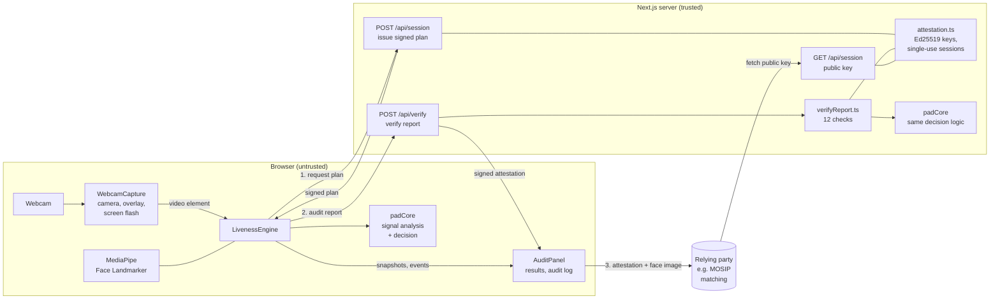
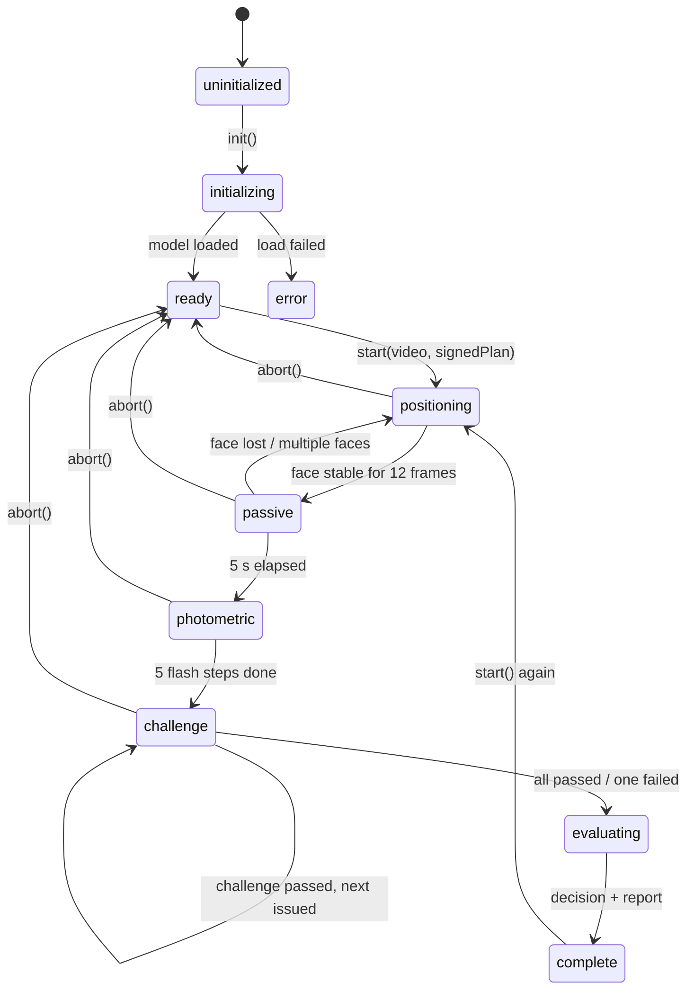
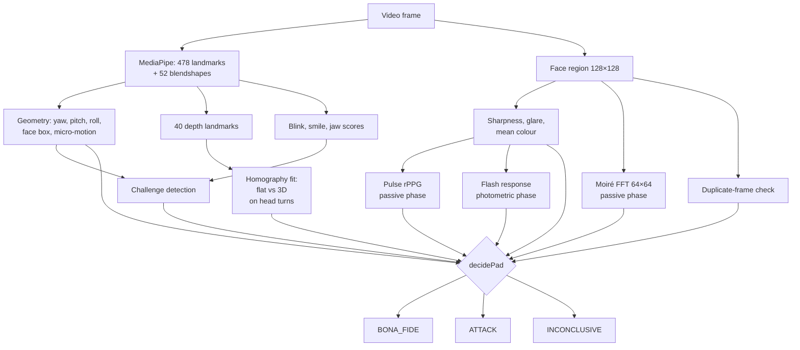
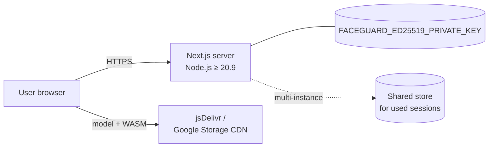

# FaceGuard Architecture

FaceGuard is a single Next.js application with two halves:

- **Browser (untrusted):** captures video, tracks the face and measures liveness signals. Video never leaves the device.
- **Server (trusted):** decides what the browser must do, checks what it reports, recalculates the decision and signs the result.

The diagrams below use Mermaid, which GitHub renders automatically.

## 1. System overview



`padCore.ts` contains the decision logic and is shared by both halves, so the server can recalculate exactly what the browser calculated, using the server's own configuration.

## 2. Components

| Component | File | Responsibility |
|---|---|---|
| Page | `src/app/page.tsx` | Creates the engine, requests the plan, sends the report for verification, holds UI state |
| WebcamCapture | `src/components/WebcamCapture.tsx` | Camera access and errors, mirrored preview, face-box overlay, challenge prompts, full-screen flash colours |
| AuditPanel | `src/components/AuditPanel.tsx` | Decision and scores, server attestation, reference image, telemetry, audit log, chain check, JSON export |
| Header | `src/components/Header.tsx` | Session status |
| LivenessEngine | `src/lib/livenessEngine.ts` | Frame loop, face measurements, session state machine, audit trail, reference capture |
| padCore | `src/lib/padCore.ts` | Session plans, depth check, flash analysis, pulse, moiré, virtual-camera detection, decision, hashing |
| Session route | `src/app/api/session/route.ts` | Issues signed plans; publishes the public key |
| Verify route | `src/app/api/verify/route.ts` | Validates the request and calls `verifyReport` |
| verifyReport | `src/lib/server/verifyReport.ts` | Runs the verification checks and signs the attestation |
| attestation | `src/lib/server/attestation.ts` | Ed25519 key, JWS sign/verify, single-use session tracking |
| Types | `src/types/index.ts` | Shared data model |

## 3. Session sequence

```mermaid
sequenceDiagram
  autonumber
  actor U as User
  participant B as Browser (engine + UI)
  participant S as Server
  participant R as Relying party (MOSIP)

  B->>S: POST /api/session
  S-->>B: plan (challenges, flash colours, nonce) + Ed25519 signature
  Note over B: Positioning: one centred, lit, frontal face
  U->>B: Holds still (5 s)
  Note over B: Passive: micro-motion, blinks, pulse,<br/>moiré, sharpness, glare; best frontal frame kept
  B->>U: Screen flashes 5 random colours
  Note over B: Measures face colour after each flash
  B->>U: Challenge prompts (≥1 head turn)
  U->>B: Performs actions
  Note over B: Head turn tested for 3D vs flat motion
  Note over B: Decision + SHA-256 of reference image,<br/>hash-chained audit trail
  B->>S: POST /api/verify { report }
  Note over S: Check plan signature, binding, expiry,<br/>hash chain, timing; recompute flash<br/>statistic and decision; single use
  S-->>B: verified + server decision + signed attestation
  B->>R: attestation + reference image
  R->>S: GET /api/session (public key)
  Note over R: Verify signature, decision, expiry,<br/>image hash → then 1:1 matching
```

## 4. Liveness engine state machine



## 5. Detection pipeline

Each video frame goes through the same pipeline; which results are used depends on the current phase.



### Signals and weights

| Signal | Weight | Detects | Method |
|---|---|---|---|
| Active challenges | 0.30 | Static photos, simple replays | Blendshape and head-pose thresholds; neutral pose required before each challenge |
| 3D depth | 0.15 | Prints, cut-outs, screens | Fits a homography (exact for any flat surface) between neutral and turned landmarks; residual measures 3D shape |
| Screen-flash reflection | 0.15 | Replays, injected streams | Correlation between flashed colours and measured face chromaticity |
| Micro-motion / blink | 0.10 | Static images | Landmark motion after removing position, scale and roll; spontaneous blinks |
| Camera integrity | 0.10 | Virtual cameras | Camera label patterns; share of pixel-identical frames |
| Pulse (rPPG) | 0.05 | Masks, photos | CHROM method; spectral peak in 45–180 bpm band |
| Moiré | 0.05 | Screen replays | Peak-to-median ratio of high-frequency spectrum |
| Texture sharpness | 0.05 | Blurry recaptures | Laplacian variance |
| Specular glare | 0.05 | Screens | Share of near-white pixels |

**Hard rules** override the score: flat motion on any head turn, no reaction to the flash, or a virtual camera always gives `ATTACK`. `BONA_FIDE` requires all challenges passed, conclusive depth and flash checks, no suspected attack of any kind, and a score of at least 0.65.

## 6. Trust boundaries and security controls

| Threat | Control |
|---|---|
| Client picks easy challenges | Server chooses challenges and signs the plan; verification rejects mismatches |
| Pre-recorded responses | Random order; neutral pose before each challenge; random flash colours chosen at session start |
| Report edited after the session | SHA-256 hash chain over all events; server re-verifies the chain |
| Report replayed | Single-use sessions; 3-minute plan expiry |
| Client fakes the decision | Server recalculates the decision with its own configuration |
| Client fakes flash results | Server recalculates the flash statistic from raw per-step data |
| Bot-speed responses | Minimum human response time (150 ms) and session duration (8 s) |
| Face image swapped after liveness | Image SHA-256 bound into the signed attestation |
| Attestation forged | Ed25519 signature; public key published as JWK |

**Remaining gap:** the server never sees video, so a fully rewritten client could submit invented measurements consistent with all checks. The mitigation path is server-side frame analysis or native apps with device attestation.

## 7. Data and privacy

| Data | Where it lives | Retention |
|---|---|---|
| Video frames | Browser memory only | Discarded frame by frame |
| Face measurements (scalars) | Audit report | Exported or sent to `/api/verify` |
| Reference face crop | Browser memory (BONA_FIDE only) | Until the page discards it or sends it for matching |
| Reference image hash | Audit report, attestation | With the report |
| Signing key | Server environment variable | Managed by the operator |
| Used session IDs | Server memory | Until plan expiry |

## 8. Deployment



- HTTPS is required in production for camera access.
- `next.config.ts` sets `Permissions-Policy: camera=(self)`, `X-Frame-Options: DENY`, `X-Content-Type-Options: nosniff` and `Referrer-Policy: no-referrer`.
- For more than one server instance, replace the in-memory used-session map with a shared store such as Redis, and share the same signing key.
